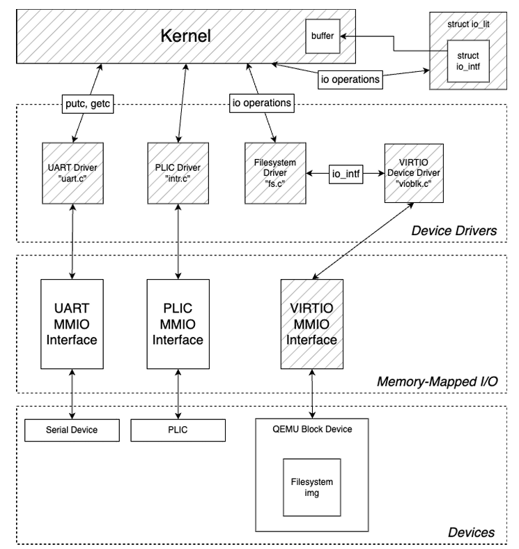
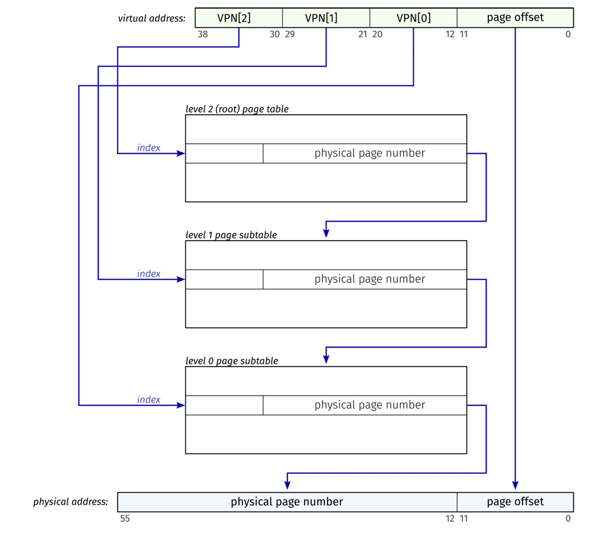
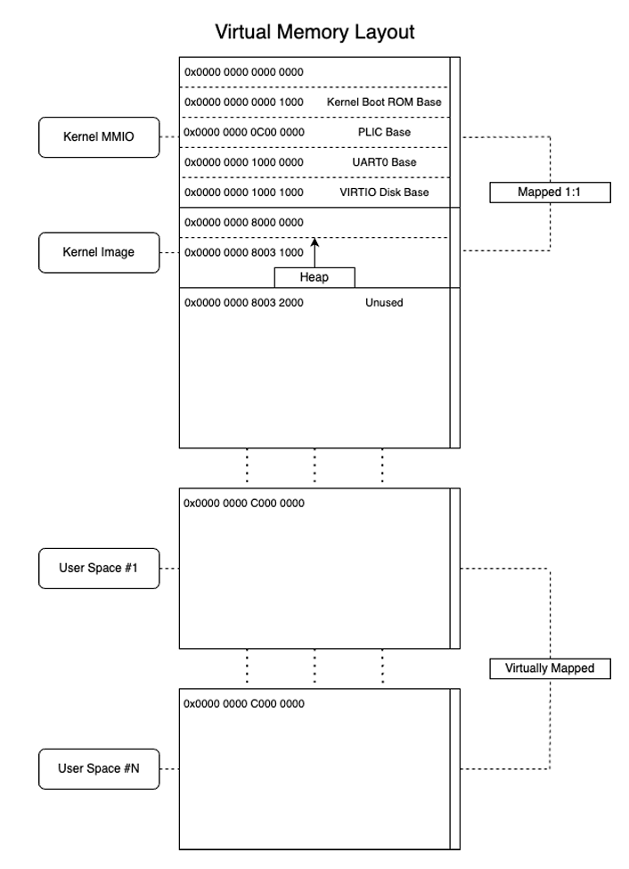
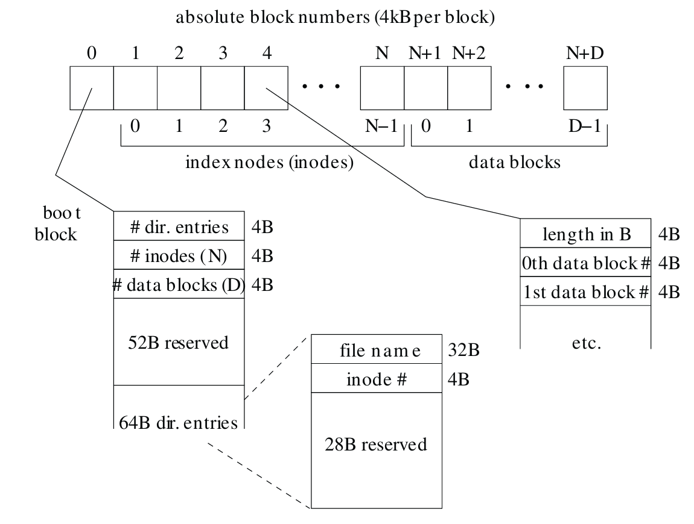
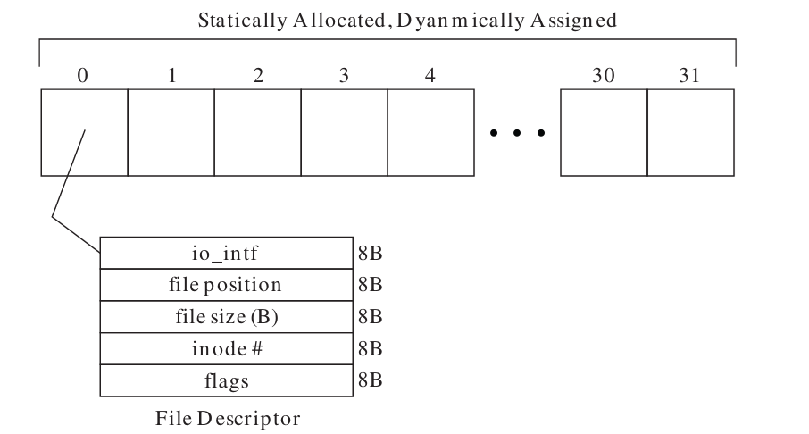

# RISC-V Unix Kernel

A compact Unix-inspired operating-system kernel written in C and RISC-V assembly for QEMU's 64-bit `virt` machine. The source implements user processes, Sv39 virtual memory, interrupt-driven devices, ELF executable loading, and a custom block filesystem.


## Architecture



The diagram shows how the kernel reaches the UART, PLIC, and QEMU block device. In this checkout, the filesystem driver is `kfs.c` and the PLIC driver is `plic.c`.

The default boot path is:

1. `start.s` configures privilege delegation and trap vectors, then enters supervisor mode.
2. `main.c` initializes memory, interrupts, devices, threads, processes, and timers.
3. UART and VirtIO devices are attached; the kernel opens `blk0` and mounts its filesystem.
4. The configured initial executable is opened, loaded from ELF, and entered in user mode.
5. User `ecall` instructions enter the syscall dispatcher; interrupt and exception handlers service devices and memory faults.

The current initial executable is `lock_test`, selected by `INIT_PROC` in `src/kern/main.c`. The default build boots this program directly. `main_shell.c` contains a separate shell entry point and is not linked by the default target.

| Subsystem | Main source files | Responsibilities |
| --- | --- | --- |
| Boot and traps | `start.s`, `trapasm.s`, `excp.c`, `intr.c`, `csr.h` | Privilege transitions, trap frames, exception and interrupt dispatch |
| Threads and synchronization | `thread.c`, `thrasm.s`, `thread.h`, `lock.h` | Ready queue, context switching, join, conditions, and locks |
| Processes and syscalls | `process.c`, `syscall.c`, `process.h` | Execution, fork, exit, descriptor inheritance, and syscall dispatch |
| Memory | `memory.c`, `memory.h`, `ezheap.c` | Sv39 page tables, 4 KiB pages, mapping permissions, address-space cloning, demand allocation, and kernel heap |
| Devices | `device.c`, `uart.c`, `plic.c`, `virtio.c`, `vioblk.c`, `timer.c` | Device registration, serial I/O, interrupt control, block storage, and alarms |
| I/O and storage | `io.c`, `kfs.c`, `elf.c` | Shared I/O interfaces, reference counting, filesystem access, and ELF loading |
| User runtime | `src/user/start.s`, `syscall.S`, `string.c` | Program entry, syscall wrappers, and string routines |
| Image generation | `src/util/mkfs.c` | Host-side filesystem image construction |

## Features and configuration

- Supervisor-mode kernel and user-mode program execution on RV64, built with `-march=rv64g -mabi=lp64d`.
- Process creation through fork, executable replacement, waiting, and exit.
- Syscalls for device/file opening, close, read, write, I/O control, diagnostic output, and timed sleep.
- Sv39 virtual addressing with page allocation, mapping, permissions, cloning, and user-memory validation helpers.
- Kernel threads with explicit yielding and condition-based blocking.
- NS16550 UART support, a platform interrupt controller, and a VirtIO block driver.
- A filesystem containing a boot block, directory entries, inodes, and 4096-byte data blocks; read, write, and file-position operations.
- User workloads including Fibonacci execution, fork demonstrations, shared-file locking, and descriptor reference-count exercises. Additional executable binaries are included in `src/user/bin`.

The default machine has **8 MiB RAM**, beginning at physical address `0x80000000`. User addresses occupy `[0xC0000000, 0xD0000000)`, with the initial stack pointer at the upper boundary. The default process and thread tables each have 16 slots; reserved entries reduce the number available to workloads. The filesystem implementation accepts at most 32 directory entries.

## Virtual memory

The kernel uses Sv39 page tables with three levels of virtual page numbers and a 12-bit offset for 4 KiB pages.



Kernel memory and device MMIO use identity mappings, while each process has its own user-space mappings.



The layout illustrates the mapping scheme; the kernel image and heap boundaries depend on the build.

## Filesystem and I/O

### On-disk layout

The filesystem image uses 4096-byte blocks: a boot block, followed by `N` inode blocks and then `D` data blocks.



- **Boot block (block 0):** a 64-byte header stores the directory-entry, inode, and data-block counts, followed by 64-byte directory entries. The format has room for 63 entries; this kernel accepts at most 32.
- **Directory entry:** a 32-byte filename, a 4-byte inode number, and 28 reserved bytes. Short names are zero-padded; a full 32-byte name need not contain a terminating zero byte.
- **Inode blocks (blocks 1 through `N`):** each stores a 4-byte file length followed by 4-byte data-block indices. Only indices needed to cover the file's length describe valid file data.
- **Data blocks (starting at block `N + 1`):** store file contents. Data-block index `i` refers to absolute block `N + 1 + i`.

### Open files and shared interfaces



`fs_open` finds a free slot in the statically allocated filesystem file table and initializes its I/O interface, current byte position, file size, inode number, and in-use flag. Reads, writes, and `ioseek` update the position. The diagram illustrates the metadata fields; their actual types and sizes are defined in `src/kern/kfs.h`.

The supplied appendix describes 32 open files per task. This implementation instead has 32 filesystem file slots shared across the kernel, and each process has 16 I/O descriptor slots by default (`PROCESS_IOMAX`).

Files and devices expose a `struct io_intf` containing an operations pointer and a reference count. Its `struct io_ops` provides `close`, `read`, `write`, and `ctl` callbacks. The common I/O helpers dispatch to these callbacks; opening is handled separately by the filesystem or device layer. The filesystem accesses the VirtIO block device through the same interface, while hardware drivers communicate with devices through MMIO.

Build `src/util/mkfs` to package user executables and other files into `src/kern/kfs.raw`. Compile user programs first, then recreate the image whenever its files are added, removed, or changed. The commands below use the paths supported by this checkout's image builder.

## Repository layout

```text
src/
  kern/       Kernel, drivers, linker script, and subsystem test sources
  user/       User runtime, workloads, linker script, and Makefile
    bin/      Included and generated user executables
  util/       Filesystem image builder
```


## Dependencies

Use a Linux or on Windows, use WSL. The build scripts rely on shell utilities and QEMU pseudo-terminals.

- GNU Make and a POSIX shell.
- bare-metal RISC-V GNU toolchain providing `riscv64-unknown-elf-gcc`, `as`, `ld`, and `objcopy`.
- `qemu-system-riscv64` with the `virt` machine and VirtIO block support.
- C compiler and POSIX headers for `mkfs.c`.
- Optionally, a RISC-V-capable GDB and a terminal client for serial pseudo-terminals.

Written and Tested using Fedora Linux 41, as well as Windows 11 with WSL.


## Build and simulate

Run these commands in a POSIX shell from the repository root. They describe the supplied build targets; execution has not been verified in this checkout.

Build the available user workloads explicitly:

```sh
make -C src/user bin/fib bin/lock_test bin/ref_test bin/init_fib_fib bin/init_fib_rule30 bin/init_trek_rule30
make -C src/util CC=cc
```

The aggregate `make -C src/user` target references missing sources, including `trek.c`, `rule30.c`, and `init3.c` through `init5.c`. Use individual available targets rather than expecting a complete rebuild of all included binaries. Avoid `make clean` in `src/user` if you need to preserve binaries whose sources are absent.

Create a fresh filesystem image and build the kernel:

```sh
cd src/kern
../util/mkfs kfs.raw ../user/bin/fib ../user/bin/lock_test ../user/bin/ref_test ../user/bin/init_fib_fib
make
make run-kernel
```

The filename arguments intentionally use `../user/bin/`: the image builder strips this prefix to produce names such as `fib` and `lock_test`. Its output path is overwritten when the command runs.


The kernel Makefile launches QEMU with `-machine virt -bios none`, 8 MiB RAM, a raw VirtIO disk, console output, and extra serial/monitor pseudo-terminals. QEMU prints the pseudo-terminal paths for external terminal connections. Use `Ctrl-a x` to exit the stdio QEMU session.

**The default `lock_test` writes to the `fib` file in the disk image.** Recreate the image before subsequent executable or filesystem tests. `ref_test` also writes to `fib`.

To boot another available workload, change `INIT_PROC` in `main.c`, include that executable and its dependencies in the image, and rebuild. For example, `init_fib_fib` requires `fib` in the image. Workloads that invoke `trek` need an executable that is not currently supplied under that name.

`companion.o` is generated by `mkcomp.sh`. If `../user/trek` exists, it embeds that file; otherwise, it creates an empty object. The default boot path loads its executable from the mounted disk rather than this embedded payload.

## Verification and debugging

The source includes manual subsystem tests and user-space exercises. Their presence does not establish that they pass.

| Test source | Intended coverage | Build integration |
| --- | --- | --- |
| `src/kern/mem_test.c` | Page allocation, mappings, permissions, validation, unmapping, and simulated fault handling | `mem-test.elf` and `mem-test` targets |
| `src/kern/elf_test.c` | I/O operations and ELF loading |  |
| `src/kern/fs_test.c` | File opening, read/write, and file-control assertions |  |
| `src/kern/vioblk_test.c` | Block reads/writes and device controls |   |
| `src/kern/process_test.c` | Initial process loading and execution | Separate entry point   |
| `src/user/lock_test.c` | Parent/child access to a shared file | Default initial program |
| `src/user/ref_test.c` | Child I/O after parent descriptor closure | Select through `INIT_PROC` |

Run the configured memory test from `src/kern`:

```sh
make mem-test
```

This target uses the same disk and serial options as the default kernel, so retain a valid `kfs.raw`. Inspect the console for individual success messages and panics. Some protection checks call simulation helpers rather than causing actual user-mode hardware faults, and the test assumes a particular physical-page allocation order.

Start the kernel paused for debugging:

```sh
make debug-kernel
```


